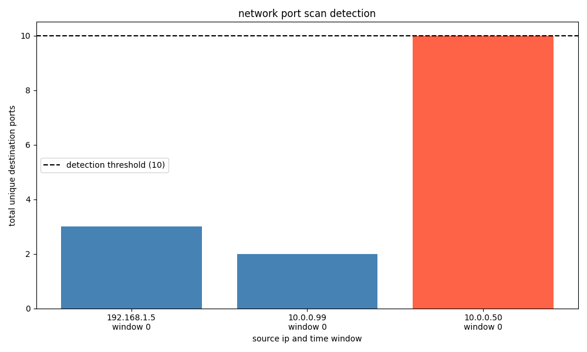

# Network Port Scan Detector

A small Python project that looks through simulated network connection logs and flags IP addresses that look like they're port scanning.

A port scan is when one machine quickly tries lots of different ports on a target to see which ones are open. Normal traffic usually touches only a few ports, so a burst of many different ones from the same IP stands out.

## How it works

Each record in the data has a source IP, a destination port and a timestamp in seconds. The script splits time into 5-minute windows and, for each IP in each window, counts how many different ports it contacted. If that count reaches 10 or more, the IP is marked as suspicious. Otherwise it's marked normal.

It then prints a report with alerts and a few stats, and saves a bar chart of the results. It uses NumPy, pandas and Matplotlib.

## Sample output



Red bars are flagged IPs, and the dashed line is the threshold of 10 ports.

## Running it

```bash
pip install -r requirements.txt
python port_scan_detector.py
```

## Limitations

- The data is simulated. The script doesn't read real network traffic, and an alert doesn't prove anything malicious is going on.
- The windows are fixed, so a scan that crosses two windows can slip through. For example, 5 ports just before second 300 and 5 more just after would never hit 10 in either window.
- A single fixed threshold can flag busy but legitimate machines, and it can miss slow scans that spread out over a long time.